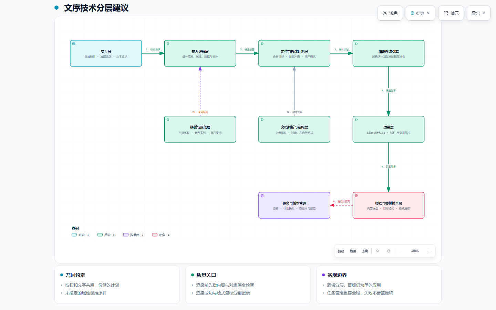

# 文序 v0.6 技术架构设计

基线日期：2026-09-21；更新日期：2026-09-27。本文面向产品与研发，定义教案格式调整的目标架构和模块边界。新增 [模板校准与金标准版本设计](specs/lesson-template-calibration.md) 已接通桌面支持子集，验收与边界见[模板验证记录](verification/template-workflow.md)。需求语义以 [需求基线](REQUIREMENTS.md) 为准；v0.5设计时差距见第5节，v0.6实现映射见第7节，模板增量见第8节。

产品目标：用户提供已写好的稿件，通过全局控件、局部选区或文字指令，修改明确指定的对象与格式属性，保留其余内容、格式和文档对象。

教案模板主流程增加一个准备阶段：自动识别有无旁批；有旁批时校验、修正文件并复核，无旁批时自动识别分类和提取现有有效样式。后续教案版本绑定相应基准文件与来源记录；无需修改的模板不经过写回流程。

preview.2使用反馈后的新设计：日常入口改为直接按金标准整理，结构分类收进标准设置/异常核对，主画面以修改后预览为主。规则需表达教案的列用途及特定行内容，区分表头/行头与填写区，按合并网格定位；用户明确调整标准后同步更新实际模板，保持文字与表格结构。该区域规则与交互调整尚未实现，本轮只改设计文档。

- [交互架构图](diagrams/wenxu-layers.html)
- [可编辑图源](diagrams/wenxu-layers.architecture.json)
- [全局与局部格式需求及验收用例](REQUIREMENTS.md)



GitHub 文件页可直接查看上面的静态图；交互 HTML 请下载或克隆仓库后用浏览器打开。图保留v0.6逻辑分层基线，新增模板状态与版本流程以模板校准设计为准，不将历史图示验收当作新功能证据。

## 1. 分层结论

用户提出的 UI 输入解析、文档解析、模板、渲染四个方向都应保留。建议进一步分成八项业务职责，另设贯穿全程的任务与版本管理。最需要补上的职责是“定位与修改计划”“精确修改”“独立校验”。

这些是逻辑模块边界。第一阶段继续使用一个 Python 应用，无需按图拆成多个服务，也无需先引入消息队列。图中数据库形状表达版本存储职责，不要求现在部署数据库；校验节点使用安全类图例表达交付检查职责。

| 分层 | 负责什么 | 主要输出 | 职责边界 |
| --- | --- | --- | --- |
| 交互层 | 上传稿件、全局控件、查找与选区、文字要求、影响预览、撤销与下载 | 用户操作、文件与选择上下文 | 显示范围、混合值与未指定项，不自行决定文档如何改写 |
| 输入理解层 | 将按钮、文字、已采用模板规则统一成范围、属性、值和例外 | EditIntent | 明确控件直接转结构数据；自然语言只产生候选意图 |
| 文档解析与结构层 | 保留原包，读取文档对象、文本位置、格式继承、语义角色和能力范围 | DocumentModel | 结构事实与“正文/标题”的推断分开；保留未识别对象 |
| 模板与规范层 | 自动选择有旁批校准或无旁批样式提取路径，管理基准与来源记录 | 基准文件及格式、角色、例外和校准/提取记录 | 有旁批且不符合要求时必须实际修正文件；无旁批以原文件现有样式为依据；普通直接编辑可不采用模板 |
| 定位与修改计划层 | 将意图落到具体对象，处理重叠范围、冲突、保护区与版本依赖 | EditPlan | 形成唯一的最终修改集合，再交给执行器 |
| 精确修改引擎 | 在当前版本副本上执行允许的属性修改 | PatchResult / 原格式候选文件 | 不重新推断用户意思，不顺手统一未指定格式 |
| 渲染层 | 使用任务选定的WPS或LibreOffice环境生成PDF、页面图片与环境记录 | RenderResult | 呈现页面效果，不负责判断修改是否正确；失败不静默切换引擎 |
| 校验与交付检查层 | 检查目标属性、未指定部分、文档对象及排版异常，汇总结果 | VerificationReport | 独立于修改器判定；区分自动检查和人工版式复核 |
| 任务与版本管理（贯穿全程） | 管理原稿、原格式副本、输入版本、计划快照、执行状态、缓存、撤销与输出版本 | 不可变版本及其来源记录 | 失败不覆盖原稿；文档或计划变化后使旧确认与缓存失效 |

图表示主要职责与依赖，省略了编排器向每个模块传递文件和上下文的连线。文档解析、输入理解和模板规则会在修改计划处汇合，并非所有操作都必须按九个模块串行经过。

## 2. 每层的关键设计

### 2.1 交互层：全局与局部是两个入口

全局面板支持正文、标题等已明确的范围，并给出字体、字号、行距、段距、缩进等控件；局部操作支持选中文字、查找定位、选择段落、表格行列或单元格。自然语言用于表达组合要求。

所有控件默认“保持原样”。加粗、斜体等布尔属性需要“保持 / 开启 / 关闭”三态。选区原本存在多个值时显示“混合”，不擅自选一个值覆盖。用户只修改字号，就只生成字号操作。

界面应显示命中对象、数量与上下文。明确选区和明确控件可直接由用户点击应用；多处同名、正文归类不确定、互相冲突或需要扩大选区时才要求消歧。不能把每次操作都变成繁琐的审批流程。

教案增量将正文、各级标题等分类展开为具体内容与位置，并允许纠正；不能只给分类数量。有旁批显示目标、实际格式、差异和未处理项；无旁批自动展示分类样式提取结果，仅对歧义项请求核对。模板版本与教案v1/v2分开展示。

上述具体信息在最新设计中移入按需设置与核对，不再与结果预览常驻并排。日常只提供紧凑操作条和当前标准，模板修订与教案版本在内部追溯，历史按需打开。

### 2.2 输入理解层：所有入口统一表达

按钮值通过确定性代码生成 EditIntent，不需要大模型。文字要求先提取范围、属性、目标值和排除项；简单表达可以继续复用现有规则解析，复杂表达以后可接模型适配器。

模型只负责理解并提出候选意图，不能直接决定 XML 修改。未知属性、缺少范围、无法解释的单位，必须留在待处理状态，不能猜测成一个可执行结果。“黑体”是字体要求，不等于“开启加粗”。

上传稿件里的正文、批注及嵌入内容默认都是文档数据。只有用户明确选择参考模板或要求分析批注规范后，相关内容才可作为候选规则来源；候选规则仍受同一套范围和冲突处理约束。

### 2.3 文档解析与结构层：保留原结构，增加定位能力

建议包含两个子模块：结构读取器负责真实对象与格式；角色识别器负责判断正文、标题、表头、教学目标等业务含义。角色识别应记录来源、强弱证据和用户修正，不能把推断当成确定事实，也不展示未经校准的置信度百分比。

DocumentModel 应保留原 DOCX 包引用、部件路径、段落/run/字符区间、表格逻辑网格与合并关系、节与页眉页脚等对象位置，以及样式继承与有效格式。显示文本上的选区必须能映射回一个或多个原始 XML 节点，而不能只存一串摘录。

对象标识必须绑定输入版本：同一版本内可稳定定位，跨版本需重新映射或复核，不能默认“第 3 段”永远指向同一个对象。

“表格内”是结构位置，“正文”是内容角色，两者是不同维度。产品必须明确正文按钮是否包含表格内正文，并展示实际命中范围，不能简单把所有表格文字排除或全部算作正文。

遇到复杂对象，应分别声明“可读取 / 可原样保留 / 可修改”的能力。可保留图片或公式，不意味着已经能修改其内部内容。在文件可可靠读取、对象关系可保全的前提下，未涉及的对象原样透传；无法满足这些前提，或请求涉及未支持的修改能力时，阻止相应操作并说明具体原因。

### 2.4 模板与规范层：校准实际文件并确立金标准

模板读取后先判定有无旁批。无旁批时复用参考实例的有效样式读取能力，按角色提取实际格式并生成规则及来源位置，绑定原文件，不调用修改器；明确结果自动形成基准，混合格式或角色不明时保留待核对项。读取器必须区分空批注集合与读取失败、未支持结构，失败不得回退成无旁批。

有旁批时，读取器保存原文与物理锚点，规则解释器确定目标角色、格式和实际作用范围；跨段落/表格及插入点旁批均需显式处理。保护整页或多个栏目等范围不能简单等同于圈中的文字。

模板校准编排复用EditIntent、EditPlan和原格式执行器，依据明确旁批修正模板文件，保存后重新读取并独立校验。适用格式冲突、解析残余、能力缺口或保全失败使文件停留在候选状态；通过后才固定金标准文件、角色、规则、例外与校准记录。不能只生成一套正确规则却保留错误模板作为后续依据。

采用金标准时，从基准文件的明确类别读取规则覆盖的有效格式，转换为EditIntent，再与本次明确手工修改生成计划。基准文件在有旁批路径为校准后的文件，在无旁批路径为原模板；无旁批规则明确标记来源为模板现有样式，未读取到的有效值不补默认值。同类多种格式不任意取第一项或多数值。目标教案重新建模定位，不复制模板的段落/字符坐标。普通直接格式编辑继续可用，完整边界见[模板校准设计](specs/lesson-template-calibration.md)。

待实现的业务区域规范须支持“列的一般填写规则＋特定行填写内容例外”，而非只有全篇正文/标题角色。行头、列头先与填写区分离；课堂小结、作业布置、板书设计内容的五号规则覆盖一般列的字号，不覆盖行头小五。具体范围仍在当前文件重新定位。用户通过标准设置明确修订的属性优先于历史旁批/提取值，校验器检查修订后的目标，并保留内容、对象和表格结构。

### 2.5 定位与修改计划层：产品可靠性的核心

该层分三步：定位实际对象；按“具体对象 × 属性”合并要求；冻结可执行计划。

定位需覆盖字符、段落、单元格/表格和节等不同粒度。字符字号作用于字符区间；段落对齐必须作用于所属段落。若操作要求扩大范围，界面需显示扩大的真实影响范围。

同一批请求中，明确的局部例外覆盖相同属性的全局设置，其他属性继续继承该批全局要求。例如“正文宋体小四，第三段改黑体”得到第三段黑体小四。不能采用整条规则覆盖，否则会错误丢失字号要求。

同一具体目标与同一属性仍有无法确定的冲突时，展示差异供用户选择。历史局部修改不自动成为永久保护区；后续用户明确全局修改同一属性时，按新的请求范围执行，只有明确设定的排除/保护规则才继续生效。

冻结的计划记录输入文件指纹、输入版本、模型/映射版本、最终对象集合、属性与值、前置条件、来源和保护项。执行前再次检查输入版本，防止把旧计划套到新文件。

### 2.6 精确修改引擎：执行计划，保持未指定部分

继续沿用现有代码对 OOXML 作有限修改的方向。只改计划列出的属性与目标节点，尽可能保留未涉及的 ZIP 部件字节和 XML 结构。不能把文档提取成纯文本后重新生成。

局部字符修改可能需要拆分 run。拆分时保留原 run 的其他属性和相邻对象；如果涉及域、批注锚点、修订或复杂容器，必须有对应能力与验证，不能直接用整段文本替换。

修改共享样式定义会影响多个对象。对局部请求，优先在已定位对象上做所需的有限修改；若将来支持直接编辑样式定义，需要先计算所有受影响对象，并作为独立范围让用户看清。

执行器产出候选副本和实际操作清单。中途失败丢弃候选，不覆盖输入版本。日志不能替代后续独立校验。

### 2.7 渲染层：固定环境，记录真实能力

现有WPS原生渲染与LibreOffice转PDF、PyMuPDF转图片继续作为已有路径。Windows桌面与网页/WSL路线按实际运行环境验收，固定字体、渲染器版本和配置；缺失字体或发生替代时给出明确记录。

输入和输出使用相同环境渲染。渲染缓存必须绑定文件哈希、渲染器版本、字体环境和参数。界面更换选区、计划或输入版本时，不得误用旧预览。

渲染器输出“渲染完成”和页数、图片，不输出“版式正确”。Linux 预览也不能自动代表 Word/WPS 中绝对一致的分页效果。

### 2.8 校验与交付检查层：前后两段检查

渲染前先检查文件结构、文字顺序、目标属性以及未指定内容/属性是否被意外改动，同时比对图片、公式、批注、关系与嵌入对象是否保全。复杂 run 拆分场景要比较语义等价和允许变更，不能仅凭 XML 字符串相同或不同下结论。

渲染后再汇总页数变化、字体替代、可检测的版式异常和前后预览。图中的校验节点表达最终汇总关口，前置结构检查属于同一个校验模块，必须在渲染之前调用。

自动检查通过、待人工版式复核、人工已确认、失败要分别记录。“生成了全部页面图片”不能写成“逐页视觉检查通过”。无法自动判断的视觉问题保留待复核状态，不虚构成功。

“其他不动”保证的是未请求的内容、格式属性和对象不被擅自改变。字号和行距调整可能自然引起换行、分页以及对象页面位置变化；这类排版后果需要展示和检查，不能承诺改变字号后页码仍完全不变。

### 2.9 任务与版本管理：让每次修改可追溯、可撤销

建议记录原始上传文件、工作基线、当前输入版本、规则来源、计划快照、候选结果、渲染信息和校验报告。成功后登记新版本；结构校验失败不登记为合格输出。视觉待复核可提供预览，但不能标成已验证通过。

撤销通过返回上一版本实现；“继续修改”明确选择上次结果作为新输入。任务指纹至少包含输入文件、最终计划、结构映射和修改引擎版本；渲染另有独立缓存键。

模板校准通过或无旁批样式提取完成后，固定模板版本、文件指纹及依据类型。采用模板的计划和教案版本额外绑定该基准及规则/分类版本；任何模板文件、旁批、规则或角色变更使旧状态失效，重新识别并走相应路径。新模板T2不静默改变绑定T1的历史教案。v1→v2仍只执行新一轮明确要求，不自动全篇重刷模板；偏离模板或采用局部例外时单独记录。

DOC 导入直接建立字节相同的原格式副本。`v06_native.py` 从本机 WPS 获取只读 WordOpenXML 快照与原生段落/字符位置，供 DocumentModel、冻结计划和独立校验使用；快照不能作为文件输出或回写。表格行结束标记通过原生标志排除；OLE 和隐藏锚点通过实际字符位置映射为不可编辑间隙。`office_bridge.ps1` 在副本的明确范围上设置白名单属性，保存 DOC 后重新打开校验。DOCX 继续执行 OOXML 最小补丁。导入保真、修改保全、页面预览和人工确认分别记录。

## 3. 建议的模块契约

| 数据对象 | 核心字段 | 约束 |
| --- | --- | --- |
| DocumentModel | document_revision、source_hash、package_ref、objects、text_spans、roles、effective_format、capabilities | 对象与定位绑定当前版本；保留原文件可回溯 |
| EditIntent | source、scope、set、exclusions、context | 未出现的属性表示不修改；不把 null 当成通用“清空” |
| EditPlan | input_revision、input_hash、resolved_targets、assignments、preconditions、rule_sources、plan_hash | 每个具体目标/属性只有一个最终值；不能包含未解决冲突 |
| PatchResult | output_ref、output_hash、applied_operations、engine_version | 记录实际执行；结果仍需独立校验 |
| RenderResult | pages、pdf_ref、image_refs、renderer_version、font_environment、warnings | 只证明渲染与环境事实 |
| VerificationReport | structural_checks、property_checks、preservation_checks、render_checks、visual_review、delivery_status | 通过、失败、待复核和未运行显式区分 |
| CommentRequirement（增量设计） | comment_ref、anchor_spans/point、source_text、role、intended_scope、set、exceptions、status | 锚点与业务作用范围分开；未理解部分和非格式要求保留，明确来源 |
| TemplateBaseline（增量设计） | template_revision、basis_kind、original_hash、baseline_file_hash、roles/rules、preparation_report、manual_items | basis_kind区分旁批校准与现有样式提取；文件及记录一致，候选不冒充金标准，教案版本明确引用 |

以下是建议协议的示意，不是现有 API：

```json
{
  "source": "ui",
  "scope": {
    "kind": "selection",
    "selection_id": "selection-17",
    "document_revision": "revision-3"
  },
  "set": {
    "font_family": "黑体",
    "font_size_pt": 10.5
  }
}
```

这个请求只包含字体、字号。颜色、粗体、行距等键不存在，执行器就不能修改它们。字体字段覆盖哪些文字脚本、如何映射至 OOXML 字体属性，由协议明确规定；不能顺带清空其他字体设置。文字输入“这几个字改成黑体五号”最终也生成同类意图。

“移除直接格式、恢复样式继承”如果以后需要，应设计为独立显式操作，不与“保持原样”混用。

## 4. 一次真实操作如何经过这些模块

用户上传教案，设置“正文宋体小四”，再要求“教学目标栏黑体五号”。

1. 导入文件，建立工作基线与 DocumentModel；保留表格、图片、批注、公式等对象信息。
2. 正文控件直接产生全局意图；文字要求产生局部候选意图。
3. 计划层识别正文对象，定位“教学目标栏”的真实单元格与段落。多处同名或合并单元格范围不明确时，由界面消歧。
4. 将字体和字号分别合并。如果教学目标内容也属于正文，它最终取黑体五号；其他正文取宋体小四。未请求的粗体、边框、行高等保持。
5. 界面显示影响范围；用户点击应用后冻结计划，执行器在输入副本上操作。
6. 校验内容和对象保全、目标属性及未指定格式；通过后渲染前后页面。
7. 展示修改清单和排版变化，区分自动通过与待视觉复核项目；按结果登记版本并提供相应输出。

如果用户只选中几个字改字号，可跳过模板和自然语言理解，仍使用同一定位、计划、执行和校验过程。

## 5. 设计时基线 现有 POC 可以复用什么

以下映射以代码版本 [`677a0a581f0c1a46a2b5d33fda385f7a8bf72a43`](https://github.com/GZUCMHjy/wenxu-docx/tree/677a0a581f0c1a46a2b5d33fda385f7a8bf72a43) 为实现基准。文件链接便于导航，行号仅对应该基准；后续功能落地时应同步更新能力声明。

| 目标模块 | 现有实现入口 | 现状与需要补充的部分 |
| --- | --- | --- |
| 交互与编排 | [app.py](../app.py#L145) | 已有上传、规则/结构确认、版本与渲染流程；需补产品化全局控件与精确局部选择 |
| 输入理解 | [parse_text_requirements](../prd_workflow.py#L197)、[normalize_rules](../prd_workflow.py#L299) | 已有确定性文本规则和单位归一；需统一成能承载局部选区、例外和来源的协议 |
| 文档解析与角色 | [build_structure_mapping](../prd_formatting.py#L120) | 已有段落角色映射；需增加版本绑定的字符区间、表格网格及更完整的对象模型 |
| 模板与规范 | [extract_reference_requirements](../prd_workflow.py#L232) | 已有参考文档抽取入口；需规则版本、出处、适用范围和明确的采用动作 |
| 修改计划 | [normalize_rules](../prd_workflow.py#L299)、[executable_rules](../prd_workflow.py#L393) | 当前按 scope/property 组织规则；需对实际重叠对象合并，产出冻结后的最终计划 |
| 修改引擎 | [apply_confirmed_rules](../prd_formatting.py#L436) | 已有对指定属性作有限 XML 修改的基础，应保留；需补字符片段和表格等对象级执行 |
| 校验 | [validate_confirmed_result](../prd_formatting.py#L404) | 已检查非目标部件与允许属性之外的变化；需围绕最终计划验证，扩展 run 拆分、复杂对象与视觉状态 |
| 渲染 | [render_docx](../prd_workflow.py#L448) | 已有 LibreOffice/PyMuPDF 路径；需把渲染完成与视觉复核分开，完善字体和环境记录 |
| 任务与版本 | [rule_fingerprint](../prd_workflow.py#L418)、[app.py](../app.py#L260) | 已有指纹、确认与版本流程；应抽出独立编排逻辑，绑定完整计划和输入版本 |

当前输入包校验会拒绝部分批注、域、公式和嵌入对象，见 [docx_formatting.py](../docx_formatting.py#L45)。因此真实教案支持需要逐项增加能力和验收，不能仅去掉拦截就宣称支持。

当前 [app.py 的检查文案](../app.py#L303) 将渲染与“逐页图像检查成功”一起呈现。后续实现应拆分状态，避免让用户误认为已有逐页视觉判断。本文记录该实现差距，不表示相关代码已修复。

## 6. 建议实施顺序与验收

以下第一至第三步均服务于同一个 P0 真实场景可用目标。第三步是工程实施次序，不表示把 DOC 导入与复杂对象保全降为可选功能；完成前两步不能宣称 P0 全部验收通过。

第一步先固定 EditIntent / DocumentModel / EditPlan 契约，把现有代码中的解析、计划、执行、校验与任务编排拆成模块。保留现有可用能力，让全局控件和文字输入共用协议。

第二步完成最关键的闭环：明确正文范围、字符与段落局部定位、按属性合并全局与局部要求、冻结计划、最小修改与撤销。用“只改几个字”和“全局字体加一个局部例外”检验，而非仅验收整个文件可以导出。

第三步围绕真实教案扩展：表格行列与合并单元格、批注/图片/公式/嵌入对象保留、.doc 导入与原格式基线。逐类公布支持能力；仍不可安全修改的对象保留原样并说明限制。

以上前三步为v0.6实施次序。2026-09-27新增的教案模板校准与分类内容展示作为必要增量优先补齐；组织模板库、复杂自然语言扩展和更丰富的排版异常检查继续后续评估。模型接入不能代替目标定位、计划冻结和校验。

在各产品线的实际运行环境执行验收，至少覆盖：

- 指定文字改黑体五号，文本、相邻字和未指定格式保持。
- 正文全局设置与局部例外按属性得到唯一结果；后续全局要求符合新输入版本语义。
- 重复文字可消歧，跨多个 run 的选区定位正确，段落级属性扩大范围可见。
- 表格合并关系、公式、图片、批注等声明可保留的对象确实保全。
- 缺失字体、无法支持的对象、结构检查失败和渲染失败均有真实状态，原稿可恢复。
- 自动检查与人工版式复核状态分开，预览和导出对应同一输入与计划。

编辑场景使用 [V06-A01 至 V06-A14](REQUIREMENTS.md)，模板与预览优先增量使用 [TPL-A01 至 TPL-A20](specs/lesson-template-calibration.md) 验收。Windows桌面在实际Windows/WPS环境验证，网页/WSL路径保留对应环境记录。架构图自身的验证范围、产物哈希与浏览器证据见 [图示说明](diagrams/README.md)，图示检查不代表产品功能验收。

## 7. v0.6 当前实现映射

当前工作分支基于 master d9c42f3 实现上面的逻辑分层，继续采用单体 Python/Streamlit 应用。第 5 节保留为设计时的 v0.5 差距记录，旧界面代码移至 legacy_app.py；不能将其 app.py 行号视为当前入口。

| 职责 | 当前模块 | 实现及边界 |
| --- | --- | --- |
| 交互 | `app.py`、`v06_ui.py` | 全局/局部/页面控件，实际对象范围、角色修正、保护、草稿与冲突、预览、撤销、下载 |
| 结构与角色 | `v06_model.py` | 版本指纹、字符区间、逻辑表格网格、栏目候选、能力清单、关系检查 |
| 输入与计划 | `v06_plan.py` | 控件与有限文字语法统一意图；属性/对象重叠合并，明确例外、保护、冻结快照 |
| 模板与基准 | `template_workflow.py`、`desktop/template_dialog.py` | 桌面已接通双路径、显式规则核对、实际文件校准和模板包；网页参考入口仍沿用原实现，未知要求继续待处理 |
| 精确修改 | `v06_patch.patch_document` | 有限 XML 属性写入、必要 run 拆分、其他 ZIP 部件透传 |
| 独立校验 | `v06_patch.verify_result` | 不调用修改器，逐字符归一比较和目标属性检查；对象/关系/未指定属性保全 |
| 导入/渲染 | `v06_session.py` | DOC 容器检查、原格式基线、同引擎独立渲染、字体环境与真实状态 |
| 任务与版本 | `EditingSession` / `Version` | 会话内原子版本、冻结报告、环境绑定缓存、去重、撤销、保护区迁移 |

代码记录与 V06-A01–A14 对应测试见 [实施与验证记录](verification/v06.md)。真实稿件结果只存本地；架构图保持逻辑职责图，无需改变图源或重新声明图示验收。DOC 原格式核对、人工版式复核及其他客户端兼容性独立判定。

## 8. 教案模板增量的实现边界

2026-09-27单样本实验确认：现有WPS读取的DOC结构快照中，25条旁批可由python-docx读取、OOXML定位，并与原生接口一一核对；人工解释后的3条明确格式要求已通过原格式试修与重新打开核验。这些是复用现有底层的证据，不是当前UI或自动规则解释已经完成。

本次已加入的职责为：模板有无旁批自动分流、无旁批分类样式自动采用、有旁批定位及保留解析残余的要求解释、业务范围与角色确认、分类内容展示、基准状态与版本绑定。继续复用参考实例提取、当前原格式执行、独立保全校验、渲染和教案版本管理，先保持单体实现。

桌面预览版1未提供模板导入及角色纠正；预览版2已通过新模板核心接通这些入口，原网页参考提取入口未扩大支持范围。普通旁批读取、回复/解决状态、锚点、结构保存分别按真实样本验证。暂不新增Microsoft Word COM后端，也不宣称二进制DOC可由python-docx直接处理。

### 2026-09-22 原格式保真契约

用户已选择保真优先，输出保留上传格式。DOC 不再强制转换为 DOCX；原格式工作副本在无修改时须与上传文件字节相同。DOC 的原生修改只接受冻结计划中的目标属性，重新打开保存结果并核对全文、范围外格式、批注关联、关系、媒体与 OLE 流；失败不登记版本。DOCX 保持现有最小补丁路线。架构图中的读取、建模、执行、校验与交付职责保持不变，精确修改引擎按原格式分派。
