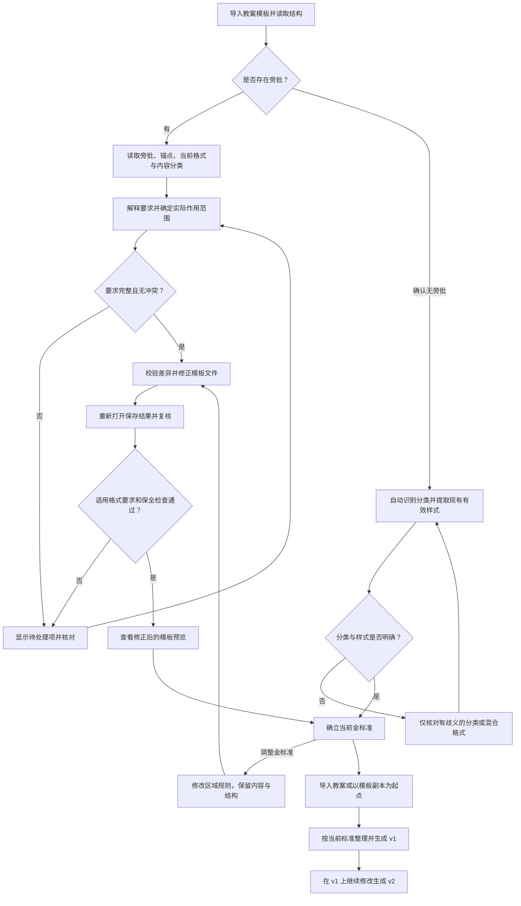

# 教案模板校准与金标准版本设计

日期：2026-09-27。面向产品、研发与验收人员。状态：本文为已确认设计；核心与Windows桌面的受控实现已接通，尚未支持的语义、结构和现代批注类型继续明确阻断或列为人工事项。实际支持范围见[桌面使用说明](../desktop-quickstart.md)，不能将目标需求表当作全部已通过的验收记录。

本轮补充状态：用户使用preview.2后要求进一步减少视觉内容，以修改后预览为主，按教案业务区域组织金标准，并允许保持内容不变地反复调整标准。下文新增区域规则和第5节交互为待实现设计，本轮只更新文档，未改代码或重新打包。

预览优先的界面状态与设置行为已进一步细化为[交互设计方案](lesson-preview-ux.md)，并提供合成内容的可交互设计稿；设计稿不改变当前程序。

## 1. 目标与适用场景

当前聚焦教案文档。导入模板后自动识别两种情况：有旁批时，按旁批要求核对并修正实际格式，复核后确立金标准；没有旁批时，自动识别内容类别并提取模板现有样式，直接作为后续教案v1、v2修改的依据，无需补写旁批或先修正模板。

**金标准必须对应实际的 Word 模板文件。** 有旁批且格式不一致时，必须修正文件本体并复核，不能只生成规则清单；无旁批时，以所提供模板的现有样式为准，提取结果能准确对应实际内容和格式即可，不强制改写文件。旁批要求已满足时也无需为了生成版本而重复保存。

需要修正时，以领导文件为底稿修改文档本体中的目标格式，保留最初收到的原始字节，另存原格式模板；DOC仍为DOC，DOCX仍为DOCX，后续从修正后的文件取值。无旁批或无需修改时，直接采用原文件及其样式提取记录，不制造内容相同的新文件。

### 当前教案的区域格式规则

以下为用户对当前教案明确给出的字体、字号要求，作为这套可编辑金标准的初始规则，不硬编码成所有学校的通用规范。表格的业务用途决定分组，不把每个检测出来的栏目名都变成日常操作选项。

| 业务区域 | 字体 | 字号 | 范围说明 |
| --- | --- | --- | --- |
| 教学过程表格的列头和行头标题 | 宋体 | 小五，9磅 | 包含表格中的栏目名称、左侧教学环节名称；不因其位于特殊行就套用填写内容字号 |
| 教学内容列的一般内容 | 宋体 | 小四，12磅 | 排除列头/行头及下述特定行填写内容；标题层级例外另行明确 |
| 师生活动与设计意图列中的内容 | 宋体 | 小五，9磅 | 只指填写内容，按列的业务身份定位，不向其他栏目扩散 |
| 课堂小结、作业布置、板书设计行对应的内容 | 宋体 | 五号，10.5磅 | 特定行的填写内容优先于一般列规则，包括明确归属该行的合并填写单元格；行头名称仍按小五处理 |

本轮只确认这些区域的字体与字号。未指定的加粗、行距、缩进等保持既有设置；不得把“小五”和“五号”混为同一字号。独立位于表格外的文档标题不能仅因文字类似而自动套用表格标题规则。

教学内容列内部的一、二、三级标题是否保留独立字号，尚未明确。这项保留为待确认的局部例外，不把“标题全部小四”或“保留此前四号标题”擅自记成用户确认的金标准。核对时只处理这一处规则冲突，不让用户重新确认其余明确区域。

## 2. 文件与版本的含义

| 对象 | 用途与约束 |
| --- | --- |
| 收到的模板原件 | 保留最初文件，不因试修、失败或撤销而覆盖 |
| 待确认模板 | 有旁批但校准未通过，或无旁批但分类/样式提取存在歧义；可查看问题，不可冒充已明确的金标准 |
| 金标准模板 T1 | 有旁批时对应校准后的实际文件，无旁批时对应原文件；同时记录分类、适用格式规则、例外/保护范围、来源类型及校准或提取记录，目标值必须与文件一致 |
| 待修改教案原稿 | 用户自己的教案，也可以是金标准文件的工作副本；不覆盖金标准 |
| 教案 v1、v2 | 每版记录父版本、本次修改及所采用的金标准版本；只改本次明确指定属性 |
| 新金标准 T2 | 模板文件、旁批要求、规则、角色或例外发生变化后重新校准或提取样式得到；不静默替换T1，也不追改已有教案版本 |

T1/T2用于内部解释和追溯模板修订，日常界面只显示当前金标准名称，历史按需查看。金标准可以继续修改，不需要用户另建一份内容不同的教案才能调整格式。历史教案继续绑定产生它时的模板；采用新标准时生成新的教案结果，不回写历史版本。

本阶段至少支持导出金标准文件和来源记录供后续使用。再次导入时核对文件指纹、规则和校准/提取记录；记录缺失、不匹配或不再适用于当前能力时，重新识别有无旁批并走相应路径。组织模板库、云端发布和跨会话恢复全部编辑历史不作为本流程的前置条件，也不因增加模板版本号就宣称已实现。

## 3. 按有无旁批选择依据

### 无旁批时自动提取现有样式

用户将文件作为模板导入后，系统确认文件中没有旁批，即自动按正文、各级标题、栏目等类别提取当前支持的有效格式，包括直接格式和样式继承后的字体、字号、加粗、段落属性等。规则记录为“来自模板现有样式”，关联对应内容位置和文件指纹；不要求用户重新输入属性或逐条确认清晰的结果。

分类与样式明确时自动形成可用基准，界面显示“模板样式已提取”，继续按该模板整理教案；不显示不存在的“旁批校验通过”，不要求点击“校验并修正模板”，也不强制另存或增加一次人工批准。用户仍可展开查看和调整提取结果。

同一类别存在多种格式时，先保留可明确识别的局部差异；无法判断统一标准还是局部例外时，显示各格式对应的具体内容，仅对这些歧义项请求核对，不能随意取第一项、最多的一项或默认值。只有字号较大等弱证据、继承后的有效值无法确定、模板缺少某一角色实例时，都不编造该角色的目标样式。

必须区分“确认没有旁批”与“旁批读取失败、类型不支持或要求未理解”。后几种情况保持待处理，不能降级成无旁批路径并绕过校准。有旁批模板仍按下述要求处理，不能因某处没有旁批就将错误样张的全部格式自动升级为规范。

### 有旁批时按要求校准

用户将文件指定为模板并选择“按旁批校准”，即明确采用该材料中的旁批作为规范来源。对范围和属性均明确的格式要求，可在一次操作中自动检查和修正，无需让用户重新输入每个字号或逐条重复确认。只有歧义、冲突、范围扩大或未支持要求需要处理。

一条旁批至少要关联：旁批原文、所在文档版本、锚点或插入点、对应正文/表格上下文、业务角色、期望属性与值、实际适用范围、例外/保护信息、解析状态和来源。自然语言中尚未理解的部分必须保留；只提取出字号不能等同于整条要求已处理。

### 锚点与作用范围

锚点是文件记录的物理位置，要求的作用范围需要结合旁批内容判断：

- 文字选区可能跨 run、多个段落或表格；范围结束标记可能位于段落之外。不能只找批注所在段落。
- 插入点旁批可以位于空白填写区；显示该单元格和栏目上下文，不能自动认定为前一句或整篇文档。
- 圈中页标题而要求整页保持不变时，保护对象是经确认的整页内容；圈中一个栏目却同时要求两个栏目时，不能只检查被圈中的栏目就标成全部满足。
- 从单个示例推及所有同类标题或正文，必须由旁批明确的类别要求或用户确认支持。校准检查覆盖该规则的所有适用对象，而不止示例锚点。
- 页码只辅助预览。实际执行绑定当前版本中的对象与字符位置；分页变化后重新定位。

### 要求分类与优先关系

| 类型 | 产品处理 |
| --- | --- |
| 明确格式要求 | 将角色、字体、字号、粗体、段落属性等转换为可检查目标；比较有效格式，保留属性继承和混合值信息 |
| 角色要求 | 旁批指定的正文、一级/二级/三级标题作为目标角色证据，核对后进入模板分类与匹配规则 |
| 局部例外 | 例如普通正文不加粗、特殊说明段加粗，分别记录范围，例外只覆盖对应属性 |
| 保护要求 | 对已明确的保护范围保持原样；普通批量修改不能越过保护。与其他要求冲突时暂停相应修改 |
| 有歧义或冲突 | 如要求全文字号一致，同时又为不同类别规定不同字号，需确认适用类别和优先关系；不按出现顺序选值 |
| 内容填写或外部资料 | 课程、班级、日期等与外部资料的核对，以及教学内容补写，保留为待人工检查项；本阶段不自动生成或改写这些内容 |
| 阶段性要求 | 模板允许的填写空位、正式教案的必填项、课后手写等区分适用阶段。未知阶段不能擅自标为不适用或通过 |
| 结构与打印要求 | 删除特定页面、编号重排、双面打印等按实际支持能力单列；不能仅改字体就声称这些要求已完成 |

当旁批明确指定的目标与样张实际格式不同，以旁批目标为校准依据。未指定的属性保持原样，不从错误样张补出默认规范。用户明确修正规范时记录修正来源，原旁批继续保留以便追溯。

用户在“调整金标准”中明确修改的属性，以本次人工设定为最新目标，优先于导入时的旁批或提取值；未修改的属性继续沿用既有规则。旧旁批保留来源作用，不得在下一次检查时将用户已确认的新标准反向改回旧值。明确局部例外与保护范围仍须参与检查。

“业务上属于一级标题”“已经应用 Word 标题样式”“外观看起来像标题”是不同事实。分类必须展示其依据；仅改大字号或加粗不能当成已写入标题样式。明确要求设置 Word 标题样式或大纲级别时，必须检查相应结构属性；当前引擎未支持该操作时保留为阻断项。

## 4. 校验、修正与确立金标准

### 有旁批时的校准闭环

1. 导入模板，建立原始字节基线，读取正文、表格、旁批及有效格式。
2. 显示角色分类和校准清单。每项展示旁批、对应内容、当前格式、要求格式、实际作用范围，以及“一致 / 需修正 / 待核对 / 未支持”的结果。
3. 用户点击“校验并修正模板”。明确且可执行的要求进入同一冻结计划；存在未解决项时可显示候选结果，但不能确立为金标准。
4. 在原件的工作副本上修改目标属性；保护文字、公式、图片、表格关系、批注内容及其关联等其他部分。失败保留原件和此前版本。
5. 重新打开实际保存的文件，重新读取目标位置的有效属性，检查内容/对象保全并渲染对照。只有内存模型或规则表变化不算修正成功。
6. 针对全部适用格式要求复核，包括修改前已经一致的范围；未解析、冲突、漏检查、未支持的适用格式项仍不能算通过。查看预览后才能“设为金标准”。
7. 固定金标准文件与校准记录。后续格式提取从这个修正后的文件中，按已确认类别和规则覆盖属性读取；保留旁批来源，禁止重新从收到的错误样张或未校准副本取值。

用户取消本次修改只代表没有执行，不能清除金标准的检查责任。确属不适用于该模板或所属阶段的要求，可以明确分类并记录原因；修改后的适用范围要重新检查，不能用“忽略错误”绕过保全或目标属性失败。

### 金标准的边界

金标准记录依据类型：有旁批表示明确适用范围内的格式已按要求校准；无旁批表示已采用该模板的现有样式，不能宣称验证过文件中不存在的规范。有旁批的记录还必须保留所有非格式、需外部资料或需人工处理的要求，显示“未自动验证”及适用阶段，不得显示为“全部旁批通过”或“教学内容正确”。无法确定旁批类型、作用范围或是否适用时，仍属于待核对，阻止确立基准。

如果模板本身需要纠正的内容属于当前不支持的范围，文件只能保持候选状态；用户完成该项处理并重新导入核验后，才可继续。明确属于未来填写阶段的空位可记录为填写要求，不由软件编造内容。模板合格与正式教案填写完整分别检查。

## 5. 以修改后预览为主的界面设计

日常工作以“打开教案 → 按金标准整理 → 查看修改后效果 → 保存”为主。默认主界面不再要求用户先选择修改范围，也不把一长串自动识别的栏目、表格编号、列号、分类树和格式控件同时铺开。这项更新取代preview.2将范围选择与格式面板常驻的做法。

### 日常修改

- 主体区域留给修改后的文档预览，默认只看当前结果，不默认同时展示原稿、规则表与分类树。
- 顶部保留紧凑操作条：打开教案、当前金标准名称、主要动作“按金标准整理”、按需对比和保存。没有模板时给出一个明确的导入入口。
- “调整金标准”作为次级入口。模板包导入导出、历史版本、旁批明细、分类纠正及临时局部修改收进按需打开的设置或更多操作，不与日常预览争夺空间。
- 当前规则摘要不必常驻；进入标准设置时再展示本模板的几个业务区域及其字体、字号。用户不需要理解“表2第3列”或重复的栏目候选名。
- 只有存在异常时，显示简短的待处理提示并定位相关内容；没有异常时不铺开检查表。处理完异常即回到结果预览。

### 调整标准与识别纠正

标准设置按“表格行列标题、教学内容、师生活动与设计意图、课堂小结/作业布置/板书设计内容”等业务区域组织。确需查看范围时，展开该规则对应的具体原文、位置和依据，再纠正识别；完整结构分类仍保留在内部和核对入口，不能直接作为日常修改菜单。

栏目名称与填写区、列的一般规则与特定行例外必须区分。合并单元格按可确认的业务归属处理，不能用固定物理列序号猜测；未知区域、同名栏目和无法确定的标题例外只暴露相关核对项。待处理项不得被隐藏后算作全部通过，也不能要求用户逐项重选已经明确的范围。

字号、加粗、编号只是识别证据，不能单独证明Word标题样式或业务层级。分类纠正不会自动改正文内容。日常少显示信息不减少内部的范围、目标属性和保全检查。

## 6. 按金标准进行 v1、v2 修改

用户选择已确立的金标准（旁批校准完成或无旁批样式提取完成），再导入教案或采用模板副本作为工作起点。系统重新识别这份教案中的角色、栏目与选区；可以复用模板的角色规范，不能复用模板的段落序号、字符坐标或页码直接修改另一份文件。

第一次按模板整理后生成 v1，之后在选定结果上继续修改得到 v2。版本记录绑定教案父版本、金标准文件指纹与版本、本次目标属性、局部例外、实际变更和检查结果。只改行距时保留 v1 的字体与其他结果；撤销回到父版本。

金标准用于“按模板校验/修正”这项明确操作。用户随后提出局部调整时，按明确意图执行，并展示与模板的偏离或已确认例外；不在每次点击时偷偷把全文重刷为模板，也不把教案改动回写到金标准。后续选择“重新按模板校验/修正”时重新展示差异，沿用已有全局/局部与保护区约定。

更改金标准文件、旁批、规则、分类或例外都会使旧基准状态失效，需按有无旁批重新校准或提取样式并建立模板版本；已生成的v1/v2保持原有内容与来源。手动改了输出文件后重新导入，必须按新输入重建位置与检查状态。

### 在同一份教案内容上反复调整金标准

用户通过“调整金标准”修改某个业务区域的字体、字号等，点击“应用并预览”后，软件将规则落实到模板文件本体并重新验证，展示这个标准产生的实际效果。用户可以继续微调并查看结果，保存后将其作为当前金标准；无需每次重新导入模板或重新解释所有旁批。

这个循环保持模板文字及顺序、教学内容、表格行列与合并关系、图片公式和批注关联不变，只调整明确指定的格式。字体字号引起的自然换行、分页变化单独展示，不等同于删改内容；不为了固定页数改动其他属性。

对当前教案采用更新后的金标准时生成新的结果版本，旧结果可恢复。模板修订和教案v1/v2的来源关系由系统记录，主界面不同时展开两套版本列表。临时局部修改与“修改金标准”区分：只有进入标准设置并明确应用的变更才更新以后采用的规范。

## 7. 技术选择与已验证边界

沿用现有单体应用和原格式处理路线：DOCX 使用 python-docx/OOXML 读取与受控修改；旧 DOC 使用既有 WPS 自动化接口读取结构快照、按原格式保存，Python 完成定位、计划与独立检查。结构快照只用于分析，不能取代原格式文件作为模板或回写输入。

本阶段不以切换 Microsoft Word COM 为前提。先补批注锚点、规则解释、范围确认、分类展示、模板状态和版本绑定，复用现有执行与保全能力。只有真实样本证明存在读取、定位或保存能力缺口时，才针对缺口比较其他引擎。不要把“保留批注”“理解批注要求”“准确修改对应内容”混为同一能力。

2026-09-27实施前授权单样本实验的非敏感汇总（下表解析器为改动前状态）：

| 实验项 | 已取得证据 | 不能据此宣称 |
| --- | --- | --- |
| 批注读取与定位 | 25条全部与WPS原生接口一一核对，其中22条范围批注、3条插入点批注 | 所有教案、所有现代批注类型都达到100%准确率 |
| 当前旁批原文解析 | 25条原文输入现有解析器，均未形成完整可执行计划；存在可提取的基本属性，但句式、范围、例外或其他要求未完全处理 | 当前产品已自动理解旁批 |
| 明确格式试修 | 人工解释3条旁批后，在4个段落执行修正；重新打开DOC后12项属性检查通过 | 已完成整份模板校准、标题样式规范化或非格式要求处理 |
| 保全与页面 | 25条批注原生内容与位置保持，文字序列无增删；9页前后页数相同，3页目标区域有变化，其余6页在同一环境下逐像素一致；变化页已目视对照 | 其他Word/WPS版本兼容、任意格式修改不重排、完整产品验收通过 |

实验使用python-docx 1.2.0与现有WPS 12,1,0,28505，页面对照为120 DPI。后续实现已将通用锚点读取、有限要求解释和校准流程接入桌面，仍未新增Microsoft Word COM后端。私有原件、文字/批注摘录、路径、快照和页面不进入仓库；本节只保存能力与结果汇总。

## 8. 新增验收场景

以下 `TPL-` 用例均为待实现、待验收的产品目标，独立于既有 `V06-` 编号。单样本实验不自动将这些用例标为通过；合成用例不使用真实教案正文或旁批。

| 编号 | 场景 | 通过条件 |
| --- | --- | --- |
| TPL-A01 | 旁批明确要求不加粗，而对应示例加粗 | 检出差异，在模板文件本体修正；重新打开实际输出验证，原始文件保持 |
| TPL-A02 | 旁批对应示例已满足要求 | 验证有效值及保全，无需重复修改；仍经过确立金标准的检查流程 |
| TPL-A03 | 同一旁批跨run、跨段落、跨表格，或只有插入点 | 正确提取原文和锚点，上下文可见；结束标记在段落外也不扩大/截断选区 |
| TPL-A04 | 旁批圈住标题却要求整页保护，或要求多个栏目 | 识别并确认真实作用范围；禁止只检查锚点就显示全部满足 |
| TPL-A05 | 全局规则与明确局部例外、互相矛盾的要求 | 按属性落实明确例外；无明确优先关系的冲突阻止确立金标准，解析顺序不改变结果 |
| TPL-A06 | 必填、外部课表、课后手写、打印等旁批 | 不遗漏、不自动编写内容；区分适用阶段、待人工事项与格式校验，不能混入“全部通过” |
| TPL-A07 | 分类含视觉标题、编号练习题、栏目标签及待归类项 | 分类可展开查看具体内容并纠正；正文不误改标题或标签，覆盖缺口显式呈现 |
| TPL-A08 | 模板基准确立后指导另一份不同内容的教案 | 有旁批依据校准后文件，无旁批依据原模板，按明确类别读取格式并重新定位目标稿；不复用旧坐标或错误原件属性 |
| TPL-A09 | v1继续修改得到v2，撤销后再修改 | 保留未指定属性和父版本关系，每版绑定金标准版本；不改变模板文件 |
| TPL-A10 | 更改模板内容、旁批、规则、角色或例外 | 旧基准状态失效，按有无旁批重新校准或提取并建立T2；既有教案保持T1绑定，切换标准须显式进行 |
| TPL-A11 | 保存失败、字段值未改对、批注关联或对象被破坏 | 不确立金标准或登记合格教案版本；原件与已有版本可用，故障原因可见 |
| TPL-A12 | 要求设置Word标题样式，或仍有未理解的适用格式要求 | 不用字号/粗体冒充结构样式；能力未支持或要求未处理时阻断，不能取消后冒充全量通过 |
| TPL-A13 | 导出并重新导入金标准，文件或校准/提取记录被改变 | 记录与实际文件及依据类型绑定；不匹配时重新识别有无旁批并处理，不复用旧状态 |
| TPL-A14 | 导入无旁批、角色与格式明确的模板 | 自动提取各类内容继承后的有效样式并形成可用基准；原文件不改写，不要求补旁批、点击校准或逐条人工确认，后续v1/v2绑定该基准 |
| TPL-A15 | 无旁批模板同类别存在多种格式或角色不明 | 显示各格式对应的内容，明确局部差异与待核对项；不取任意值、不编造缺失角色样式，仅处理歧义项 |
| TPL-A16 | 旁批读取失败、类型不支持或无法理解 | 不误报“无旁批”，不走自动采用样张格式的降级路径；问题明确显示 |
| TPL-A17 | 按本次教案业务区域应用字体字号 | 教学内容一般部分为宋体小四；师生活动/设计意图及表格行列标题为宋体小五；课堂小结/作业布置/板书设计填写内容为宋体五号，行头与填写区不混淆 |
| TPL-A18 | 特定行与一般列相交或存在合并单元格 | 明确的特定行填写规则优先，识别不清只提示相关区域；不将行头改为五号，不按固定列序号错误覆盖 |
| TPL-A19 | 同一模板上反复修改金标准并预览 | 新目标写入实际模板并复核，内容与表格结构保全；旧旁批不反向覆盖人工新标准，历史结果不被改写 |
| TPL-A20 | 使用已确定的金标准进行日常修改 | 主界面以结果预览为主，一次“按金标准整理”即可应用；不要求先选栏目/范围，无异常不展示完整检查或结构清单 |

本次文档确认的是“有旁批先校准文件，无旁批自动提取现有样式，再按金标准整理教案”的产品闭环。开发完成后，应逐项补充上述验收证据再更新功能状态。
